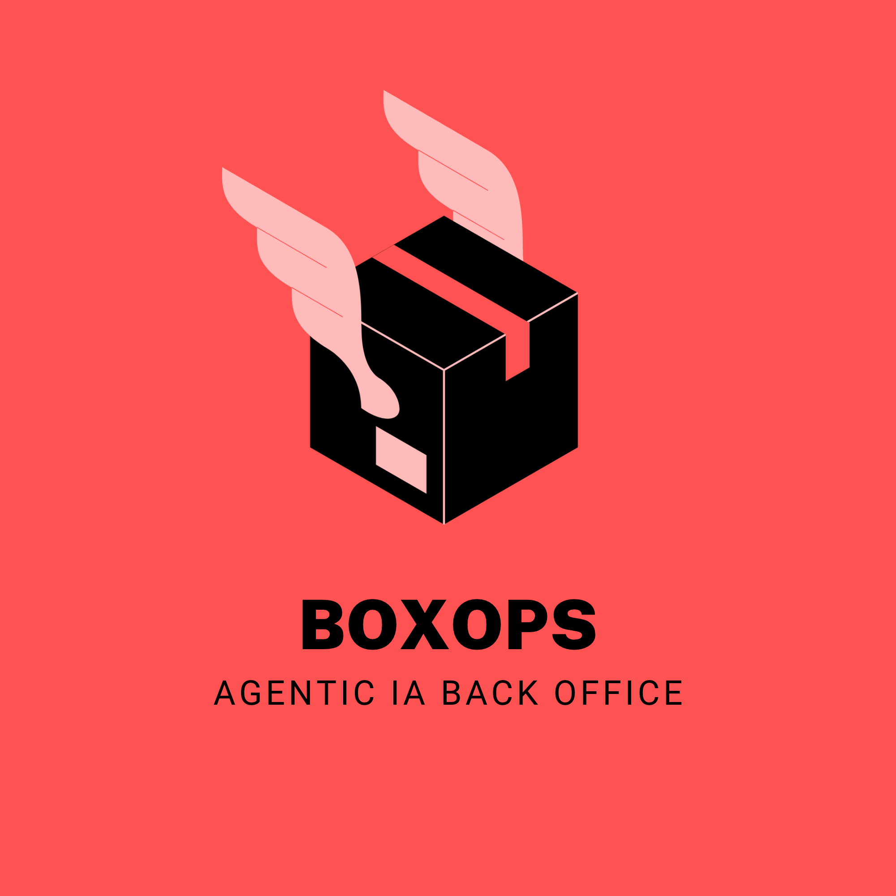

<p align="center">
  
</p>

# BoxOps

A minimalist backoffice with an AI-powered assistant for managing IKEA-style furniture catalogs, inventory, and product specifications.

> **Status:** under active development.

---

## Features

- **Product management dashboard**: full CRUD to add, edit, and remove furniture items.
- **Hybrid AI assistant**: a chatbot that picks the right source for each question.
  - **Structured data (SQL):** the agent calls tools that query the database for direct facts such as prices, designers, names, and short descriptions.
  - **Unstructured knowledge (RAG):** similarity search through ChromaDB for fuzzy or detailed questions, such as maximum weight capacity or assembly tips.
- **Real-time UI feedback:** the interface shows what the assistant is doing at each step (*Searching database...*, *Querying RAG...*, *Compiling results...*) and surfaces errors clearly.

---

## Tech Stack

| Layer | Technologies |
|---|---|
| Backend | Django, Python, LangGraph, LangChain |
| Data | PosgresSQL (With `pgvector` extension) |
| Frontend | React, Vite, TailwindCSS, Typescript |
| Deployment | Docker, Docker Compose |

---

## How the assistant works

The assistant is a [LangGraph](https://langchain-ai.github.io/langgraph/) agent that loops between the model and its tools until it can answer:

```text
User question
     │
     ▼
   agent ──► needs a tool? ──yes──► tools (SQL / RAG) ──┐
     ▲                                                  │
     └──────────────────────────────────────────────────┘
     │ no
     ▼
  Final answer
```

- The **SQL tool** answers precise questions about catalog data.
- The **RAG tool** answers questions that depend on long or descriptive product content.
- The agent decides which tool to use, and can use both for a single question.
- Each step is streamed to the frontend, which is how the UI displays live progress.
- The loop is bounded by a maximum number of turns, so the agent can never run indefinitely.

---

## Project Structure

```text
boxops/
├── backend/
│   ├── Dockerfile
│   └── ...
├── frontend/
│   ├── Dockerfile
│   └── ...
├── .env.example
└── docker-compose.yml
```

---

## Getting Started

### Prerequisites

- [Docker](https://docs.docker.com/get-docker/) with Docker Compose
- An Anthropic API key

### 1. Clone the repository

```bash
git clone https://github.com/ubert-guertin/boxops.git
cd boxops
```

### 2. Configure the environment

```bash
cp .env.example .env
```

Then open `.env` and set your API key:

```text
ANTHROPIC_API_KEY=your_key_here
```

### 3. Build and run

```bash
docker compose up --build
```

### 4. Open the app

| Service | URL |
|---|---|
| Frontend dashboard | http://localhost:3000 |
| Backend API | http://localhost:8000 |

To stop the application, press `Ctrl+C`, then run `docker compose down`.
